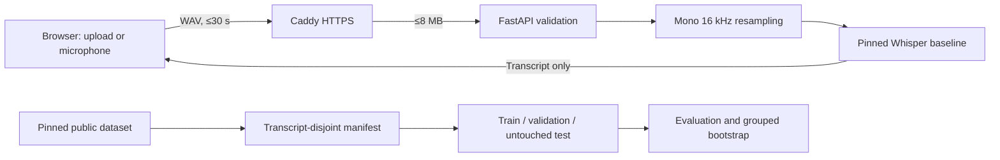

# Medical Speech Lab

**A reproducible English medical-symptom ASR study with a bounded live inference demo.** The repository evaluates a pinned Whisper tiny baseline on transcript-disjoint data, tests sensitivity to synthetic noise, and provides a complete path to fine-tuning and final held-out evaluation. The web app accepts short recordings and displays the baseline transcript without storing uploads.

> **Research status — 1 November 2026:** baseline and noise experiments are measured on validation. The full GPU fine-tuning run and final test comparison are pending. The deployed demo, if enabled, serves the **pretrained baseline**, not a clinically validated model.


## Measured validation results

The [pinned public dataset mirror](https://huggingface.co/datasets/Hani89/medical_asr_recording_dataset) contains 6,661 short English symptom utterances. We repartitioned all source clips by normalized transcript hash so the same phrase never crosses train, validation, and test. The 649-clip validation partition has 65 unique normalized phrases; 557 test clips remain untouched.

| Input to pinned `openai/whisper-tiny.en` | WER ↓ | CER ↓ | Fixed symptom-term recall ↑ |
| --- | ---: | ---: | ---: |
| Clean validation audio | **17.01%** | 9.88% | 38/68 (55.88%) |
| Same clips + seeded 10 dB white Gaussian noise | 32.17% | 21.49% | 20/68 (29.41%) |

The paired WER increase is **15.16 percentage points**; transcript-group bootstrap (65 groups, 1,000 samples, seed 42) gives a 95% percentile interval of **12.54–17.94 points**. This is an artificial-noise sensitivity check, not a clinical-noise benchmark. Both evaluations reproduced from clean commit `5064084`; exact revisions, software versions, commands, and limitations are in [RESULTS.md](RESULTS.md).

## What is built

- **Research pipeline:** pinned dataset/model revisions; transcript-disjoint split; stereo-to-mono conversion; train/validation audio audit; Whisper fine-tuning; corpus WER/CER; exact lexical symptom-term recall; paired, phrase-group bootstrap; deterministic noise stress test.
- **Inference service:** FastAPI with one loaded model per process, one in-flight inference, bounded WAV streaming, duration and sample validation, 16 kHz resampling, readiness and liveness checks, and explicit research-only metadata.
- **Web demo:** responsive upload and microphone flow, in-browser WAV conversion, transcript review/copy, clear loading/error states, and measured benchmark context. The UI never sends audio to another origin.
- **Deployment:** Docker image with the pinned public baseline baked in; Caddy HTTPS, request-size limit, and a dedicated AWS CloudFormation stack with Systems Manager access and no SSH port.



## Run locally

Use Python 3.11 or 3.12. Install a PyTorch build appropriate for your machine from the [official selector](https://pytorch.org/get-started/locally/). CPU is sufficient for the public demo and small smoke checks; full fine-tuning requires a working CUDA GPU.

```powershell
python -m venv .venv
.\.venv\Scripts\Activate.ps1
python -m pip install torch==2.12.0
python -m pip install -r requirements-dev.txt
python -m unittest discover -s tests -v
uvicorn medspeech.service:app --host 127.0.0.1 --port 8000
```

Open `http://127.0.0.1:8000`. The first model load may take time; `/health/ready` returns 200 once ready. The browser can upload audio or record through a microphone on localhost/HTTPS. API documentation is at `/docs`.

### API contract

```bash
curl -X POST http://127.0.0.1:8000/api/v1/transcribe \
  -H 'Content-Type: audio/wav' \
  --data-binary @short_recording.wav
```

The endpoint accepts a raw WAV body up to 8 MB, 30 seconds, one or two channels, and 8–48 kHz. It returns a transcript, clip duration, processing time, model identifier, and research-only flag. Invalid input returns 413/415/422; simultaneous work may receive 429. The service does not write audio or transcripts to disk or application logs. It is a low-traffic research demo without authentication or an SLA; **do not upload patient information**.

## Reproduce the study

The source dataset is fetched from Hugging Face at revision `8b2b2bd4233140705f1f7bb48411b49cd188d89c`. It is not committed here. The baseline model is pinned at `87c7102498dcde7456f24cfd30239ca606ed9063`.

```powershell
python -m medspeech.prepare --out runs/split_manifest.json
python -m medspeech.audit --manifest runs/split_manifest.json --split train --out runs/audit_train.json
python -m medspeech.audit --manifest runs/split_manifest.json --split validation --out runs/audit_validation.json
python -m medspeech.evaluate --manifest runs/split_manifest.json --split validation --model openai/whisper-tiny.en --revision 87c7102498dcde7456f24cfd30239ca606ed9063 --out runs/baseline_validation
python -m medspeech.evaluate --manifest runs/split_manifest.json --split validation --model openai/whisper-tiny.en --revision 87c7102498dcde7456f24cfd30239ca606ed9063 --snr-db 10 --noise-seed 42 --out runs/baseline_validation_10db
python -m medspeech.compare --baseline runs/baseline_validation/predictions.jsonl --candidate runs/baseline_validation_10db/predictions.jsonl --out runs/clean_vs_noise.json
```

Choose new output paths if those directories already exist. Outputs, transcripts, model weights, and Hugging Face caches are ignored by Git. The [methodology](docs/METHODOLOGY.md) defines normalization, terms, split rules, and interpretation. The [data audit](docs/DATA_AUDIT.md) records the actual channel and duration properties.

### Fine-tuning and final comparison

The training code passed a four-train/two-validation CPU smoke run and checkpoint reload. That is **not** evidence of model improvement. With CUDA PyTorch installed and `torch.cuda.is_available()` returning `True`, use a fresh output directory:

```powershell
python -m medspeech.train --manifest runs/split_manifest.json --out checkpoints/whisper_tiny_full --epochs 3 --batch-size 2 --gradient-accumulation 8
python -m medspeech.evaluate --manifest runs/split_manifest.json --split validation --model checkpoints/whisper_tiny_full/best_model --out runs/finetuned_validation
```

Select the checkpoint and freeze all preprocessing, decoding, and term choices using validation only. The final test command intentionally requires `--final-test` and disallows a row limit:

```powershell
python -m medspeech.evaluate --manifest runs/split_manifest.json --split test --final-test --model openai/whisper-tiny.en --revision 87c7102498dcde7456f24cfd30239ca606ed9063 --out runs/baseline_test
python -m medspeech.evaluate --manifest runs/split_manifest.json --split test --final-test --model checkpoints/whisper_tiny_full/best_model --out runs/finetuned_test
python -m medspeech.compare --baseline runs/baseline_test/predictions.jsonl --candidate runs/finetuned_test/predictions.jsonl --out runs/final_comparison.json
```

Do not claim a test improvement until these full runs are complete. If settings change after viewing test results, treat the test as exploratory and obtain a fresh holdout for a confirmatory claim.

## Deploy

See [deployment instructions](docs/DEPLOYMENT.md) for Docker Compose, AWS CloudFormation, health checks, updates, and teardown. The standard image bakes in the public pretrained baseline; fine-tuned weights are never pushed to GitHub. The CloudFormation stack incurs ongoing EC2, storage, and public IPv4 charges.

## Repository guide

| Path | Purpose |
| --- | --- |
| `medspeech/` | Data protocol, audio processing, training, evaluation, comparison, and API |
| `web/` | Same-origin browser demo |
| `tests/` | Offline protocol, audio, comparison, and API tests |
| `deploy/` | Caddy, Compose, and AWS infrastructure |
| `docs/METHODOLOGY.md` | Experimental design and claims boundary |
| `docs/DATA_PROVENANCE.md` | Source attribution and redistribution limits |
| `RESULTS.md` | Measured metrics and remaining experiment |
| `terms.txt` | Fixed lexical symptom terms used in the benchmark |

## Limits and responsible use

The dataset contains short prompted utterances, not physician dictation or patient conversations. Speaker IDs are unavailable, so the split does not establish speaker independence. The small English term list is a lexical probe, not medical entity extraction. The source mirror carries an Apache-2.0 tag, but original Kaggle/Figure Eight audio redistribution rights remain unverified; this repository includes **no source audio or transcripts**. The model can omit or invent medically important words. This project does not establish clinical safety, multilingual ASR, diarization, or healthcare compliance. See [data provenance](docs/DATA_PROVENANCE.md) and the [implementation plan](docs/IMPLEMENTATION_PLAN.md).
